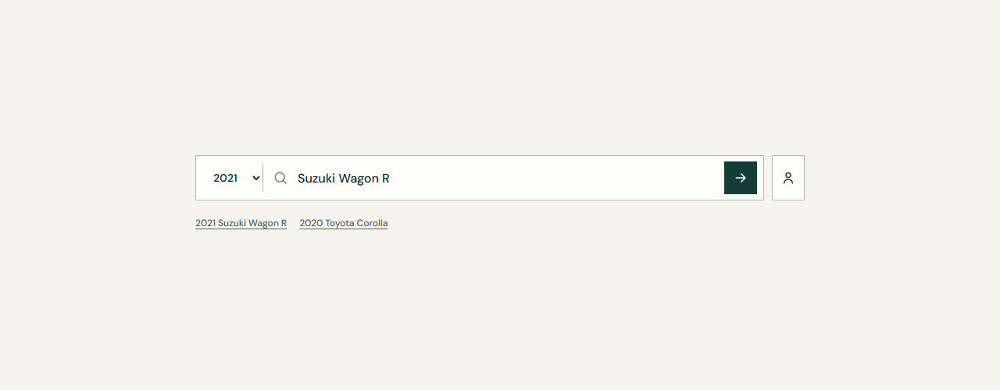
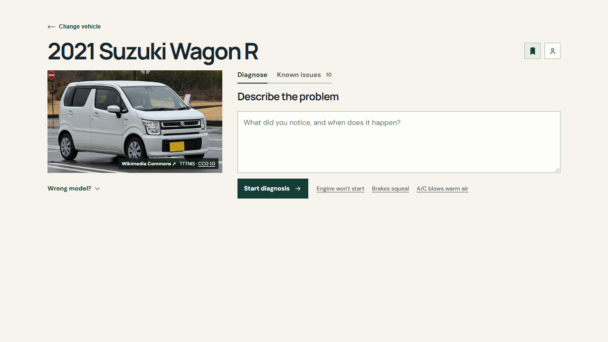
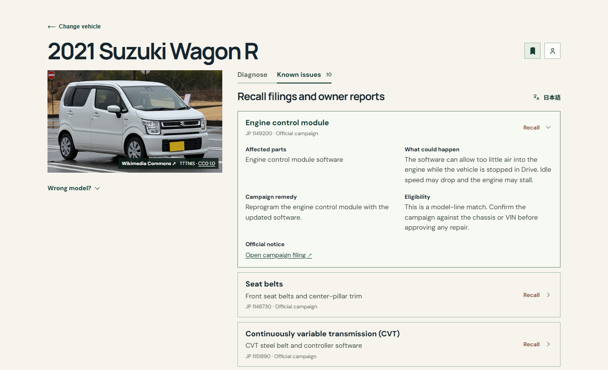
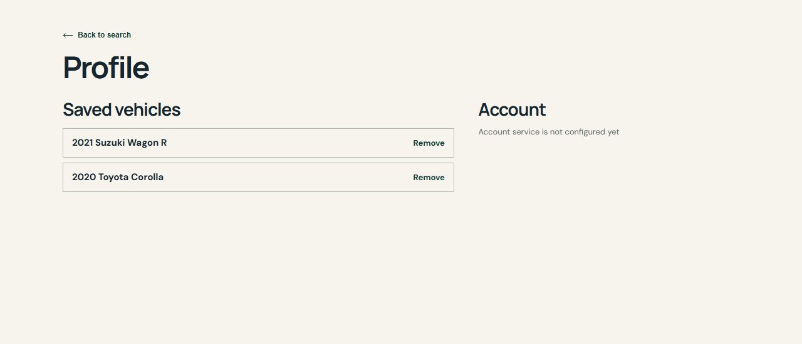
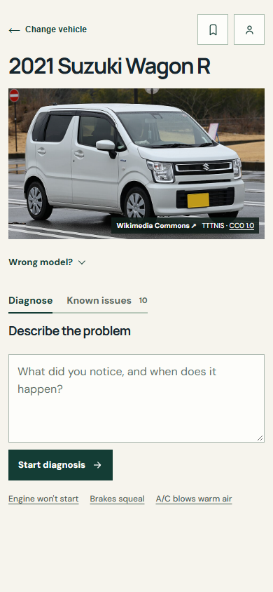

# Auto Lookup

A vehicle lookup app for finding model-year photos, reviewing recalls and owner reports, and working through common symptoms with guided diagnosis.

## Run locally

Start the preview with Node.js. This project has no npm dependencies.

```powershell
node dev-server.mjs
```

Open [http://127.0.0.1:4174](http://127.0.0.1:4174). The public data sources are available in the local preview. To enable Supabase or CarsXE, set the corresponding environment variables listed in [`.env.example`](.env.example) in your shell before starting.

## Using Auto Lookup

- Choose a model year and search by make or model. You can also paste a full search such as `2021 Suzuki Wagon R`. The five most recent lookups appear beneath the search field.
- Open **Diagnose** and describe a symptom to get a follow-up question and a suggested next check.
- Open **Known issues** to review recall filings and owner reports. Where original Japanese text is available, the language button switches between it and the English view.
- Use **Wrong model?** to narrow the photo by trim or body style. The bookmark on the vehicle page adds it to **Profile → Saved vehicles**, where you can reopen or remove it. Saved vehicles and recent searches are stored in the current browser.

## Screenshots

### Search and recent lookups



### Vehicle photo and diagnosis



### Known issues



### Saved vehicles



### Mobile layout



The Suzuki Wagon R image in the screenshots is a CC0 reference photo by TTTNIS. [Wikimedia Commons file](https://commons.wikimedia.org/wiki/File:2017-2022_Suzuki_Wagon_R_Hybrid_FX.jpg)

## Data sources and caching

Auto Lookup combines the NHTSA vehicle catalogue, recalls, and owner complaints with CarsXE specifications and photo references. Wikimedia Commons provides public photo matches.

Known-issue coverage also includes Japan MLIT recall filings and owner defect-report summaries through Data Butler's no-auth verified-data API. These model-line records link back to the official filing and must be checked against the vehicle's chassis number before treating a recall as applicable.

1. Reopen a recent search below the search bar or search by year, make, and model. Recent searches and unexpired lookup results are kept in the browser.
2. On a browser cache miss, the API checks its in-memory cache, then Supabase if configured.
3. On a server cache miss, use the connected user's CarsXE key or the server key. Photo lookups use the requested trim when supplied. Wikimedia Commons provides public photos when its file metadata identifies the requested year or year range, model, and optional trim or body style.
4. Cache the normalized result with an expiration time. A matching photo can be unavailable when neither source has coverage.

Successful photo and vehicle detail lookups normally live for 30 days, recalls and complaint patterns for 7 days, and the free NHTSA catalogue for 180 days. Incomplete results and public fallback results that can be upgraded through CarsXE expire sooner.

The cache stores image references and source metadata. The Wagon R reference photo shown above is bundled with the app.

## Deploy with Vercel + Supabase

1. Import this repository into Vercel.
2. Install Supabase from the Vercel Marketplace and connect it to the project.
3. Run [`supabase/schema.sql`](supabase/schema.sql) in the Supabase SQL editor.
4. Add the project secrets in Vercel.
   - `CARSXE_API_KEY`
   - `GEMINI_API_KEY`
   - `GEMINI_MODEL` (optional, defaults to `gemini-3.8-flash`)
5. Confirm the Supabase integration added `SUPABASE_URL`, `SUPABASE_PUBLISHABLE_KEY`, and `SUPABASE_SECRET_KEY`.
6. Open **Authentication → URL Configuration** in Supabase and configure the site and redirect URLs.
   - Set **Site URL** to the production Vercel URL, for example `https://auto-lookup.vercel.app`.
   - Add that same production URL to **Redirect URLs**.
   - For Vercel previews, optionally add `https://*-kentuckyfb.vercel.app/**`.
7. Redeploy.

The browser handles Supabase's confirmation fragment, stores the session, removes the tokens from the visible URL, and opens the signed-in profile. New signups explicitly request the current site origin as their confirmation destination, so that origin must be in Supabase's redirect allow list.

CarsXE and Gemini use server-side Vercel environment variables; API keys are never sent to the browser. Vehicle data is read from the Supabase cache first, so a cached lookup does not spend another CarsXE credit until it expires.

Guided diagnosis sends the selected year, make, model, original symptom, and prior answers to Gemini's Interactions API. Gemini asks up to four distinct observable questions and returns a strict JSON response for consistent display. Results include likely causes, affected parts, checks, repair-versus-replacement guidance, timeframe, urgency, and safety advice.
